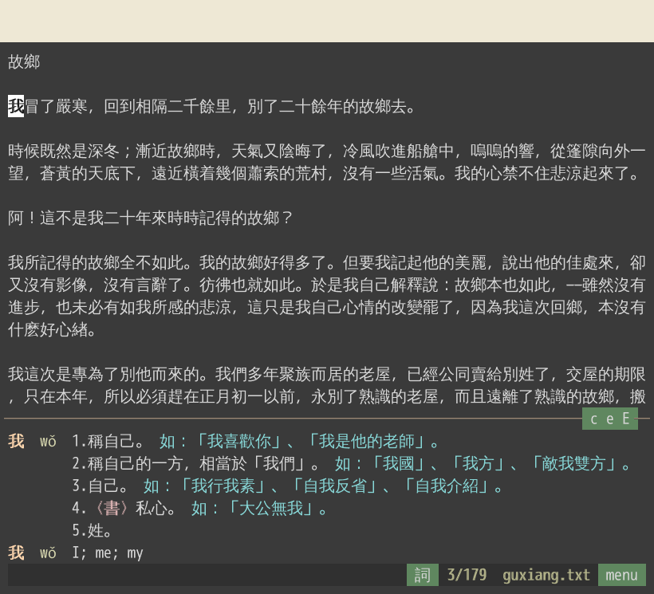

# zhread

An integrated reader, dictionary, and Anki sentence miner for Chinese text
files. Definitions are shown as you read, and if you select a word and make an
Anki card, the card includes the sentence it came from.



Two types of cards are made: cloze cards for word recall given the context
and definition; and definition recall cards given the word in context.


## Install

You need Go 1.24 or later, make, curl, and Python 3 with venv.

- **macOS:** `xcode-select --install`, then `brew install go` (or the
  installer from <https://go.dev/dl/>).
- **Ubuntu:** `sudo apt install make curl python3-venv`, then `sudo snap
  install go --classic` (apt's Go is too old on 24.04 and earlier).

Then build zhread and download the dictionaries:

```sh
git clone https://github.com/caleb-lindgren/zhread.git
cd zhread
make            # builds bin/gozhread
make dict       # downloads and builds the dictionaries, about 16 MB
```

To run it from anywhere, `sudo make install` copies it to /usr/local/bin.
An installed copy can't find the dictionaries by itself, so add
`export ZHREAD_DICT=/path/to/zhread/dict` to your shell profile.

`make dict` gets the two dictionaries zhread needs: CC-CEDICT (English) and
the Taiwan Ministry of Education's dictionary (Chinese). Two optional extras
add more definitions and Taiwan readings:

```sh
make dict ARGS="--csld --wikt"
```

`--csld` adds 兩岸詞典, the cross-strait dictionary, which becomes the main
Chinese source; its license allows personal use only. `--wikt` adds English
Wiktionary, and streams a 1.2 GB download, which takes several minutes.

## Getting started

1. **Set up Anki, once:** in Anki, File > Import `anki/zhread.apkg`. This
   adds the zhread note type and its card designs.
2. **Read:** `zhread book.txt`. The file must be UTF-8 plain text; convert
   others first, as `iconv -f GB18030 -t UTF-8 old.txt > book.txt`.
3. **Look words up:** move the cursor with the arrow keys, vi's `h j k l w b`,
   or the mouse. The definitions of the word under the cursor appear below the
   text. See [Reading](#reading) for the key commands and mouse controls.
4. **Make a card:** press Enter on a word or double-click it, or select a
   phrase and press Enter. The card maker opens with the sentence as the
   context: choose the definitions that fit, adjust the context, and press
   Enter to save. See [Making a card](#making-a-card) for its key commands and
   mouse controls.
5. **Study:** in Anki, File > Import your card file,
   `~/.local/share/zhread/cards.tsv` on macOS and Linux alike; see [The card
   file](#the-card-file) for Windows and for finding it in Anki's file dialog.
   Import the whole file each time: cards Anki already has are updated, not
   duplicated, and keep their review history.

zhread is made for modern Chinese. In classical Chinese, its default word
splitting often joins characters that are separate words. To only look up
individual characters, press `s` or click 詞 at the right of the status line,
or start zhread with `-chars`; `s` or a click on 字 switches back. In this mode,
you can still select multiple characters with Shift, `v`, or the mouse to look
up a longer word.

## Keys and mouse

`gh` or F1 lists the keys, in the reader and in the card maker. Buttons have a
green background.

The arrows, vi's keys and the mouse all work by default. To use only some,
start zhread with `-controls`: `-controls arrows,vi`, for one, leaves the mouse
to the terminal, to select text as usual.

Each table below gives an action's arrow key, vi key and mouse command; a —
means there is none.

### Reading

| Action                                              | Arrows             | vi                             | Mouse                                           |
| --------------------------------------------------- | ------------------ | ------------------------------ | ----------------------------------------------- |
| move by word                                        | ← →                | `w b`                          | click                                           |
| move by character                                   | Ctrl-← Ctrl-→      | `h l`                          | click                                           |
| move by line                                        | ↑ ↓                | `j k`                          | click                                           |
| move by paragraph                                   | Ctrl-↑ Ctrl-↓      | `{ }`                          | click                                           |
| page down, up                                       | PgDn PgUp          | `^F ^B` (`^D ^U`: half a page) | wheel                                           |
| start, end of the text                              | Ctrl-Home Ctrl-End | `gg G`                         | —                                               |
| search forward, back; repeat                        | `/ ?`, `n N`       | `/ ?`, `n N`                   | —                                               |
| select                                              | Shift-arrows       | `v V`                          | drag                                            |
| end a selection                                     | Esc                | Esc                            | click                                           |
| make a card for the word or selection               | Enter              | Enter                          | double-click a word; click "Enter: make a card" |
| undo the last card                                  | `u`                | `u`                            | click undo, after saving; or menu               |
| show or hide English definitions                    | `e`                | `e`                            | click `e` on the definitions' rule              |
| show or hide Taiwan readings                        | `t`                | `t`                            | click `t` on the rule                           |
| show or hide quotations                             | `x`                | `x`                            | click `x` on the rule                           |
| also show MoEDict, Wiktionary                       | `c`, `E`           | `c`, `E`                       | click `c`, `E` on the rule                      |
| single characters instead of words; again for words | `s`                | `s`                            | click 詞 or 字 in the status line                 |
| scroll the definitions                              | Alt-PgDn Alt-PgUp  | `J K`                          | wheel over them                                 |
| look up words inside a definition; back out         | Tab, Shift-Tab     | Tab, Shift-Tab                 | click in it; click the text above               |
| bookmark this line; go to the bookmark              | `m`, `'`           | `m`, `'`                       | menu                                            |
| list every key                                      | F1                 | `gh`                           | menu                                            |
| quit                                                | `q`                | `q`                            | menu                                            |

In macOS's Terminal, tick "Use Option as Meta key" (Settings > Profiles >
Keyboard) so that Option-arrows work.

### Making a card

The card maker lists the context, then the definitions; tick the ones the card
should have. To edit the context, press `i` on it or double-click it, and type:
the arrows, Home, End, Backspace and Delete work as in any editor, and vi's
keys work too.

| Action                                         | Arrows                          | vi                              | Mouse                                               |
| ---------------------------------------------- | ------------------------------- | ------------------------------- | --------------------------------------------------- |
| move through the context and definitions       | ↑ ↓ (PgUp PgDn: ten)            | `j k`                           | click a line                                        |
| tick or untick a definition or context         | Space                           | Space                           | click its `[ ]`                                     |
| move the context's start a clause left, right  | Shift-← Shift-→                 | `[ ]`                           | click `<start` `start>`                             |
| move the context's end a clause left, right    | Alt-← Alt-→                     | `{ }`                           | click `<end` `end>`                                 |
| edit the context                               | `i`; Esc until back in the list | `i`; Esc until back in the list | double-click it; or menu                            |
| move another context up, down the card's order | `< >`                           | `< >`                           | menu                                                |
| save the card                                  | Enter                           | Enter                           | click save                                          |
| edit the word's existing card instead          | `u`                             | `u`                             | click "u: edit it" when shown; or menu              |
| skip to the next word of a selected phrase     | `n`                             | `n`                             | menu                                                |
| show or hide quotations, MoEDict, Wiktionary   | `x`, `c`, `E`                   | `x`, `c`, `E`                   | click `x c E` at the bottom right                   |
| cancel                                         | Esc                             | Esc                             | click cancel; it asks first if you changed the card |
| answer a question                              | its key                         | its key                         | click the answer, as "y: yes"                       |
| list every key                                 | F1                              | `gh`                            | menu                                                |

## Reader options

```sh
zhread [options] FILE
```

| Option           | Meaning                                                                                 |
| ---------------- | --------------------------------------------------------------------------------------- |
| `-cards FILE`    | the card file (default: `~/.local/share/zhread/cards.tsv`)                              |
| `-dict DIR`      | the dictionary directory (default: `$ZHREAD_DICT`, else the checkout's `dict/`)         |
| `-chars`         | look up single characters instead of words, as for classical Chinese                    |
| `-pin`           | keep the cursor's line a quarter of the way down the screen (default: scroll as needed) |
| `-controls LIST` | the ways to work zhread: any of `arrows`, `vi`, `mouse`, comma-separated (default: all) |
| `-pron cn`, `tw` | show Mainland readings first (the default), or Taiwan ones                              |
| `-deck NAME`     | the Anki deck a new card file imports into (default: `main`)                            |
| `-demo`, `-gif`  | for making the demo GIF; see [SPEC.md](SPEC.md#the-demo)                                |

| Variable         | Meaning                                                               |
| ---------------- | --------------------------------------------------------------------- |
| `ZHREAD_DICT`    | the dictionary directory, as `-dict`                                  |
| `ZHREAD_FONT`    | the font of zhread's own window (default: Liberation Mono, 24 pixels) |
| `ZHREAD_WINDOW`  | `0` to always run in the current terminal                             |
| `XDG_DATA_HOME`  | moves the default card file to `$XDG_DATA_HOME/zhread/cards.tsv`      |
| `XDG_STATE_HOME` | moves bookmarks to `$XDG_STATE_HOME/zhread/bookmarks`                 |

Without `-pin`, the text scrolls only when the cursor would leave the screen,
and the wheel scrolls the text under the cursor. With `-pin`, every move
scrolls the text instead, so the cursor's line never moves and the text stays
put while the definitions below it change height; the wheel then moves the
cursor a line a notch.

zhread runs in the terminal you start it from. If you have
[st](https://st.suckless.org) and a graphical desktop, it opens in an st window
of its own instead, and gives you your shell back at once.

## The card file

zhread saves cards to `cards.tsv` in `.local/share/zhread` in your home folder:

| System  | Card file                                                |
| ------- | -------------------------------------------------------- |
| macOS   | `~/.local/share/zhread/cards.tsv`, in `/Users/NAME`      |
| Linux   | `~/.local/share/zhread/cards.tsv`, in `/home/NAME`       |
| Windows | `%USERPROFILE%\.local\share\zhread\cards.tsv` (untested) |

`-cards FILE` uses another file, and `XDG_DATA_HOME` moves the default.

`.local` is a hidden folder on macOS and Linux, so Anki's File > Import
dialog doesn't list it. Type the path instead: on macOS, press Cmd-Shift-G and
paste `~/.local/share/zhread/cards.tsv`; on Linux, type it into the dialog's
file name box.

To fix a card, edit it in the card file, not in Anki: the next import
overwrites Anki's copy. Back the card file up; it's the record of everything
you've carded.

## Optional: the Kai font

The cards set traditional characters in a Kai (楷書) font, the handwriting
style taught in Taiwan's schools, when your system has one, e.g. Windows has
標楷體. Otherwise they use your system's usual Chinese font, which works just
as well. For the Kai shown above, the Taiwan Ministry of Education's standard
Kai, add it to Anki once:

1. Download and unzip
   <https://language.moe.gov.tw/001/Upload/Files/site_content/M0001/edukai-5.0.zip>.
2. Rename `edukai-5.0.ttf` to `_edukai.ttf` and copy it into Anki's media
   folder, in your Anki profile's folder (`User 1` unless you renamed it):
   - macOS: `~/Library/Application Support/Anki2/User 1/collection.media`
   - Windows: `%APPDATA%\Anki2\User 1\collection.media`
   - Linux: `~/.local/share/Anki2/User 1/collection.media`
3. Sync, and AnkiMobile and AnkiDroid get the font too.

The leading `_` tells Anki to keep the file even though no card links to it.
The font is free to use and share unchanged (CC BY-ND 3.0 TW, from Taiwan's
Ministry of Education).

## More

- [SPEC.md](SPEC.md): everything in detail: every key, how contexts and
  cards are chosen, how the cards look and rotate their contexts in Anki,
  Taiwan and Mainland readings, segmentation, and the demo.
- [dict/README.md](dict/README.md): each dictionary, where it comes from, and
  how it is built.

## License

The code is licensed under the Apache License 2.0 ([LICENSE](LICENSE)). The
dictionaries keep their own licenses, listed in [NOTICE](NOTICE) and
[dict/README.md](dict/README.md).

The reader's colors, and the orange of the Anki cards in dark mode, are
Zenburn's, by Jani Nurminen (<https://github.com/jnurmine/Zenburn>), in the
256-color values of the port in vis by Marc André Tanner and others
(<https://github.com/martanne/vis>). zhread copies the color values only, not
code from either project.
