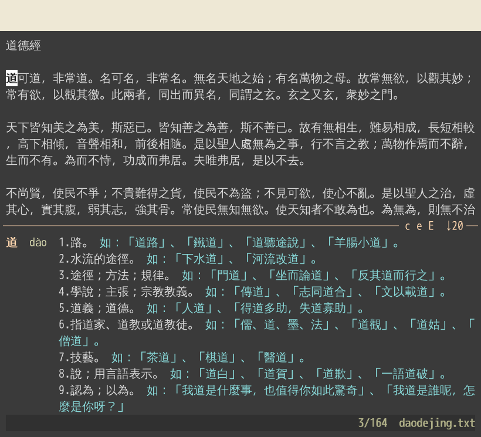

# zhread

An integrated reader and dictionary for Chinese text files that makes Anki
cards of the words you select, each with the context of the sentence it came
from. Two types of cards are made: cloze cards for word recall given the
context and definition; and definition recall cards given the word in context.




## Install

You need Go 1.24 or later, make, curl, and Python 3 with venv.

- **macOS:** `xcode-select --install`, then `brew install go` (or the
  installer from <https://go.dev/dl/>).
- **Ubuntu:** `sudo apt install make curl python3-venv`, then `sudo snap
  install go --classic` (apt's Go is too old on 24.04 and earlier).

Then build zhread and download the dictionaries:

```sh
git clone https://github.com/caleb-lindgren/zhread.git
cd zhread
make            # builds bin/gozhread
make dict       # downloads and builds the dictionaries, about 16 MB
```

To run it from anywhere, `sudo make install` copies it to /usr/local/bin.
An installed copy can't find the dictionaries by itself, so add
`export ZHREAD_DICT=/path/to/zhread/dict` to your shell profile.

`make dict` gets the two dictionaries zhread needs: CC-CEDICT (English) and
the Taiwan Ministry of Education's dictionary (Chinese). Two optional extras
add more definitions and Taiwan readings:

```sh
make dict ARGS="--csld --wikt"
```

`--csld` adds 兩岸詞典, the cross-strait dictionary, which becomes the main
Chinese source; its license allows personal use only. `--wikt` adds English
Wiktionary, and streams a 1.2 GB download, which takes several minutes.

## Getting started

1. **Set up Anki, once:** in Anki, File > Import `anki/zhread.apkg`. This
   adds the zhread note type and its card designs.
2. **Read:** `zhread book.txt`. The file must be UTF-8 plain text; convert
   others first, as `iconv -f GB18030 -t UTF-8 old.txt > book.txt`.
3. **Look words up:** move the cursor with the arrow keys or vi's `h j k l w
   b`. The definitions of the word under the cursor appear below the text.
4. **Make a card:** press Enter on a word, or select a phrase with `v` and
   press Enter. In the preview, Space ticks the definitions that fit the
   sentence, `[ ] { }` move the start and end of the context, `i` edits it,
   and Enter saves the card. Esc cancels.
5. **Study:** in Anki, File > Import your card file,
   `~/.local/share/zhread/cards.tsv`. Import the whole file each time: cards
   Anki already has are updated, not duplicated, and keep their review
   history.

To fix a card, edit it in the card file, not in Anki: the next import
overwrites Anki's copy. Back the card file up; it's the record of everything
you've carded.

## Keys

| Key                 | Action                                      |
| ------------------- | ------------------------------------------- |
| arrows, `h j k l`   | move (← → move by word)                     |
| `w b`               | next word, previous word                    |
| `/ ?`, `n N`        | search forward, back; repeat                |
| `v V`, Shift-arrows | select                                      |
| Enter               | make a card of the word or selection        |
| `u`                 | undo the last card                          |
| `e`                 | show or hide English definitions            |
| `t`                 | show or hide Taiwan readings                |
| `x`                 | show or hide quotations                     |
| `c`, `E`            | also show MoEDict, Wiktionary               |
| `J K`               | scroll the definitions                      |
| Tab, Shift-Tab      | look up words inside a definition; back out |
| `m`, `'`            | bookmark this line; go to the bookmark      |
| `gh`, F1            | list every key                              |
| `q`                 | quit                                        |

The mouse works too: click to move, drag to select, scroll with the wheel. In
macOS's Terminal, tick "Use Option as Meta key" (Settings > Profiles >
Keyboard) so that Option-arrows work.

## Options

```sh
zhread [options] FILE
```

| Option           | Meaning                                                                         |
| ---------------- | ------------------------------------------------------------------------------- |
| `-cards FILE`    | the card file (default: `~/.local/share/zhread/cards.tsv`)                      |
| `-dict DIR`      | the dictionary directory (default: `$ZHREAD_DICT`, else the checkout's `dict/`) |
| `-pron cn`, `tw` | show Mainland readings first (the default), or Taiwan ones                      |
| `-deck NAME`     | the Anki deck a new card file imports into (default: `main`)                    |
| `-demo`, `-gif`  | for making the demo GIF; see [SPEC.md](SPEC.md#the-demo)                        |

| Variable         | Meaning                                                               |
| ---------------- | --------------------------------------------------------------------- |
| `ZHREAD_DICT`    | the dictionary directory, as `-dict`                                  |
| `ZHREAD_FONT`    | the font of zhread's own window (default: Liberation Mono, 24 pixels) |
| `ZHREAD_WINDOW`  | `0` to always run in the current terminal                             |
| `XDG_DATA_HOME`  | moves the default card file to `$XDG_DATA_HOME/zhread/cards.tsv`      |
| `XDG_STATE_HOME` | moves bookmarks to `$XDG_STATE_HOME/zhread/bookmarks`                 |

zhread runs in the terminal you start it from. If you have
[st](https://st.suckless.org) and a graphical desktop, it opens in an st window
of its own instead, and gives you your shell back at once.

## More

- [SPEC.md](SPEC.md): everything in detail: every key, how contexts and
  cards are chosen, how the cards look and rotate their contexts in Anki,
  Taiwan and Mainland readings, segmentation, and the demo.
- [dict/README.md](dict/README.md): each dictionary, where it comes from, and
  how it is built.

## License

The code is licensed under the Apache License 2.0 ([LICENSE](LICENSE)). The
dictionaries keep their own licenses, listed in [NOTICE](NOTICE) and
[dict/README.md](dict/README.md).

The reader's colors, and the orange of the Anki cards in dark mode, are
Zenburn's, by Jani Nurminen (<https://github.com/jnurmine/Zenburn>), in the
256-color values of the port in vis by Marc André Tanner and others
(<https://github.com/martanne/vis>). zhread copies the color values only, not
code from either project.
